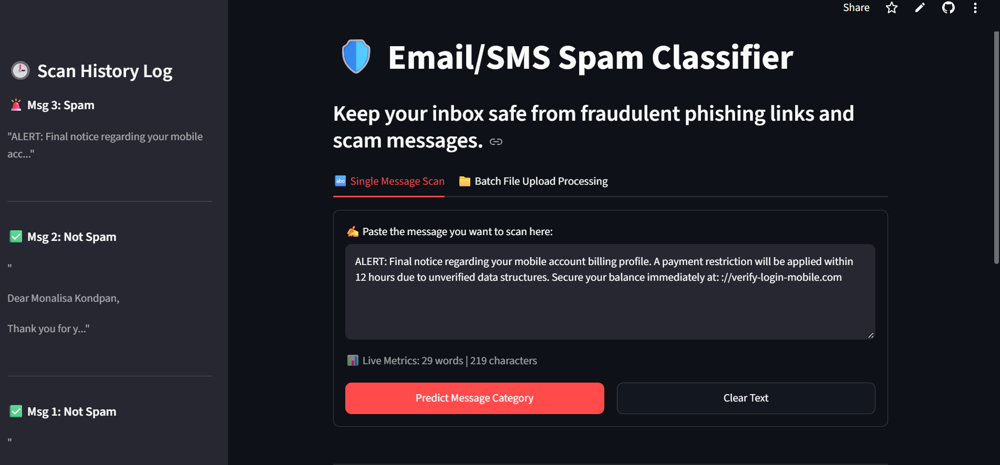
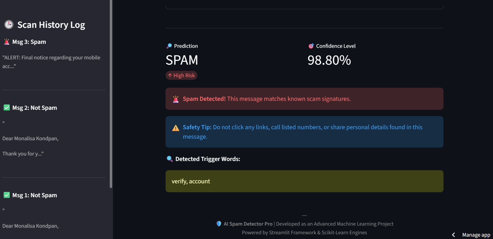
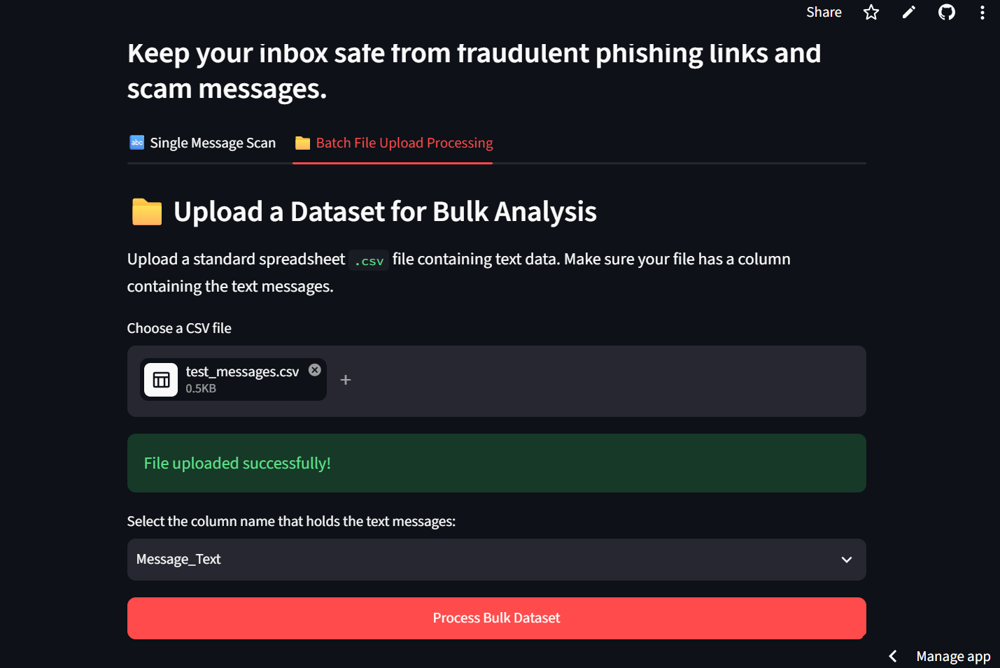
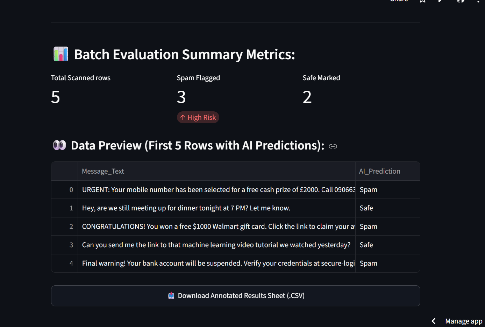

# 🛡️ Advanced AI Spam Detector Pro

An end-to-end Machine Learning web application that analyzes incoming text messages and email contents to detect fraudulent phishing scams, promotional spam, and hazardous links with high mathematical precision.

## 📸 Project Interface Walkthrough
<p align="center">
  
  
</p>
<p align="center">
  
  
</p>

## 🚀 Live Project Website
👉 **Click here to test the live application:** [https://ai-spam-detector-pro.streamlit.app](https://ai-spam-detector-pro.streamlit.app)

## 🧠 Core Machine Learning Architecture
* **Algorithm:** Multinomial Naive Bayes (MNB) with customized alpha smoothing (`alpha=0.05`).
* **Text Pipeline:** Character-Level N-gram Feature Extraction (`ngram_range=(3,5)`), allowing the model to analyze sub-word patterns and catch spammers' formatting tricks (like dashes or currency symbols) that traditional word-tokenizers miss.
* **Feature Scope:** Tuned up to 10,000 max character feature definitions to isolate high-risk patterns.

## ✨ Advanced Features Built:
1. **Interactive User Workspace:** Beautiful web layout with customized red/green container alerts.
2. **Live Metrics Calculator:** Automatic character and word counter updates.
3. **Trigger Keyword Panels:** Dynamically scans texts to reveal the exact high-risk tokens flagging the message.
4. **Session History Trackers:** Dynamic stateful sidebar monitors and logs all calculations during active user browsing.
5. **Batch Processing Pipelines:** Dedicated file uploader panel supporting drag-and-drop bulk processing of complete `.csv` spreadsheets with structural results export.

## ⚙️ Installation & Local Setup Instructions

1. **Clone the Repository:**
   ```bash
   git clone https://github.com
   cd sms-spam-classification
   ```

2. **Install Required Package Dependencies:**
   ```bash
   pip install streamlit scikit-learn pandas nltk
   ```

3. **Launch the Local Development Web App Server:**
   ```bash
   streamlit run app.py
   ```
